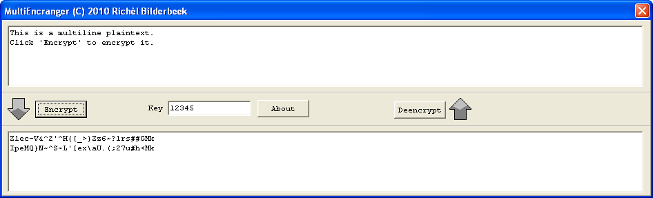

# MultiEncranger (VCL)

Multi-line version of Encranger.

MultiEncranger (VCL) is one of [Richèl Bilderbeek's tools](https://richelbilderbeek.github.io/tools/).

## Links

- [Source code](https://github.com/richelbilderbeek/MultiEncrangerVcl)
- [Richèl Bilderbeek's tools](https://richelbilderbeek.github.io/tools/)
